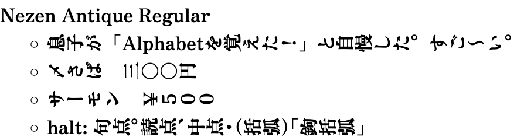

# 寝禅 / Nezen

[Zen Antique](hhttps://fonts.google.com/specimen/Zen+Antique)や[Zen Kaku Gothic Antique](https://fonts.google.com/specimen/Zen+Kaku+Gothic+Antique)などのフォントの和文字を 90 度回転させた「寝禅 / Nezen」を作りました。縦書きで文章を表現することが難しいシステムで縦書きを実現することを目的に作成されました。

横になって行う禅の寝禅が名前の由来です。

## 対応

- 和文字・一部の記号を 90 度回転、縦書き用グリフに差し替え
- halt 対応
- `U+FF5E` に `U+301C` を割り当て

## ライセンス / LICENSE

- ソースコード：[MIT](LICENSE) © [Daiji256](https://github.com/Daiji256)
- フォント：[SIL OPEN FONT LICENSE Version 1.1](fonts/NezenAntique/OFL.txt)
